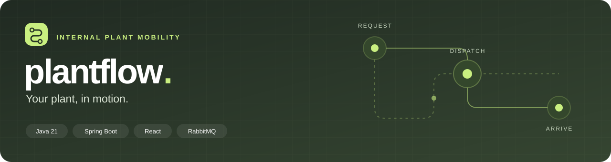
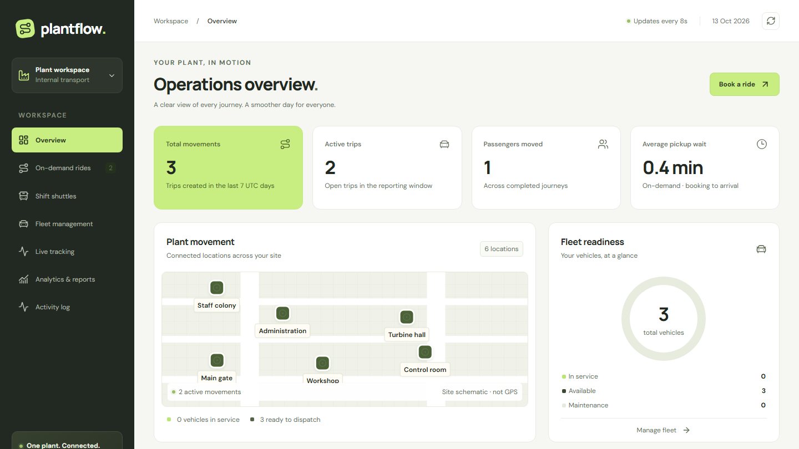
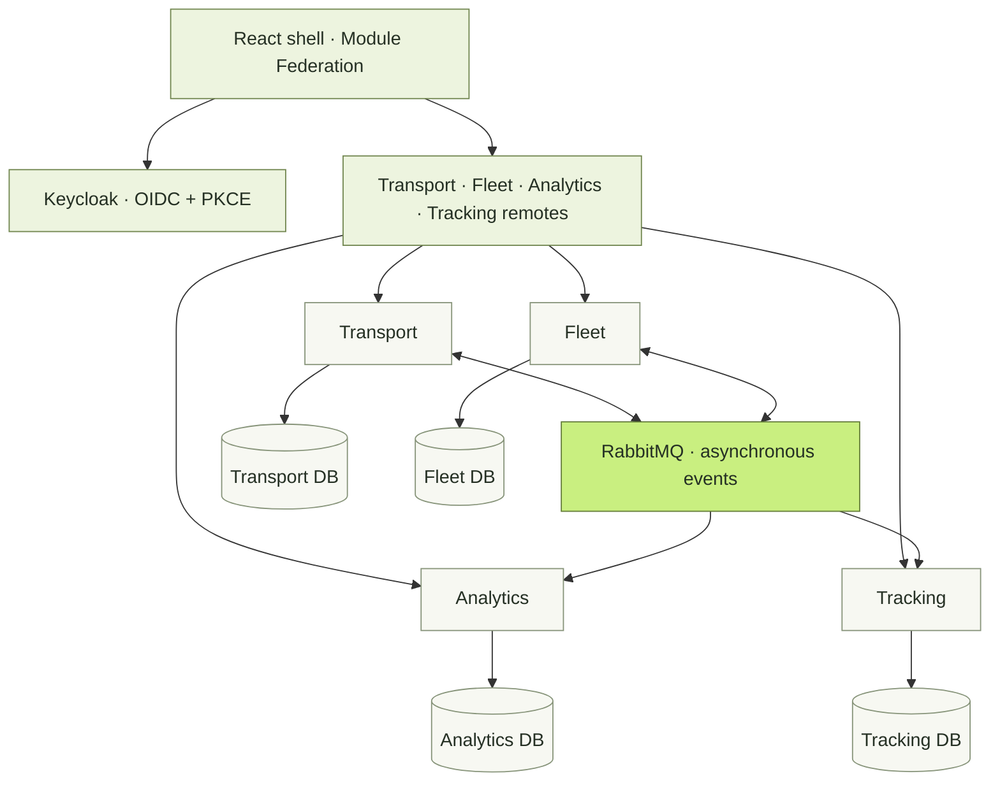

<div align="center">



**On-demand rides · Shift shuttles · Live fleet visibility · Operational analytics**

A connected transport workspace for power plants and industrial sites.

[Explore](#the-workspace) · [Quick start](#quick-start) · [Architecture](#how-it-connects) · [Documentation](#documentation)

</div>

---

## The workspace

From an employee's first ride request to a dispatcher's last shift handover, PlantFlow brings internal movement into one place. Book a journey, assign a vehicle, follow an active trip, and see the results in your operations dashboard.



<p align="center"><sub>Actual local demo dashboard. The plant overview is a labeled site schematic; GPS positions appear in the live tracking module.</sub></p>

| Book & move | Dispatch & operate | Measure & improve |
| --- | --- | --- |
| On-demand employee rides | Asynchronous vehicle and driver assignment | Trip volumes and completion rate |
| Scheduled shift shuttles | Fleet availability and maintenance state | Passengers moved and pickup wait |
| Capacity-checked seat reservations | Driver arrival, start and completion | Daily trends and route reports |
| Opt-in location sharing | Authorized live positions and freshness | CSV exports and operational activity |

> [!NOTE]
> **Working single-plant MVP.** Booking, dispatch, trip completion, reporting and browser location sharing are implemented. A vehicle GPS ingestion API is included; the hardware provider and its adapter are still to be selected.

## Quick start

**You need:** Docker Desktop with Linux containers, Node.js 20.19+ or 22.12+, and npm. Java 21 is needed for backend development and tests outside Docker; Maven Wrapper is included.

**1. Clone the project**

```powershell
git clone https://github.com/saurabh-codespace/PlantFlow.git
cd PlantFlow
```

**2. Start infrastructure and backend services**

```powershell
powershell -NoProfile -ExecutionPolicy Bypass -File .\infra\start-dev.ps1
```

The setup script generates local secrets and starts PostgreSQL, RabbitMQ, Keycloak and the four application services.

**3. Start the frontend**

```powershell
cd frontend
npm ci
npm run dev
```

Open **[localhost:5173](http://localhost:5173)** and sign in through Keycloak.

<details>
<summary><strong>Demo accounts & your first journey</strong></summary>

All accounts below use **`PlantFlow123!`** in the local development realm.

| Sign in as | Explore |
| --- | --- |
| `employee` | Request a ride or reserve a shuttle seat |
| `dispatcher` | Assign vehicles and drivers; view fleet, tracking and reports |
| `driver`, `driver2`, `driver3` | Update assigned trips and opt into location sharing |
| `admin` | Explore application administration access |

Try a complete journey in separate browser profiles:

1. **Employee:** request a ride between plant stops.
2. **Dispatcher:** assign an available vehicle and driver. Assignment confirms asynchronously.
3. **Assigned driver:** mark arrival, start the trip, then complete it.
4. **Dispatcher:** watch fleet availability and analytics update as events are processed.

Demo seeds include stops, vehicles, a driver roster and pending requests. Reports reflect persisted activity; historical success metrics and GPS points are not fabricated. Scheduled shuttles reserve their vehicle and driver until completion and cannot depart early.

</details>

<details>
<summary><strong>Ports, configuration & testing from a phone</strong></summary>

If ports are occupied, configure alternatives in `frontend/.env` using the [frontend guide](frontend/README.md). Preserve an existing `.env` when following setup steps.

Published ports bind to loopback. Browser geolocation requires localhost or HTTPS. A phone's `localhost` refers to the phone itself: use an HTTPS development hostname with matching Keycloak redirects, issuer and frontend configuration to test from another device.

The local demo uses HTTP, development accounts and debug logging. See the [security guide](docs/security.md) before exposing it beyond your machine.

</details>

## How it connects

**Four Spring Boot services. Four React remotes. Each module owns its job and data.**



| Module | Owns | Port |
| --- | --- | --- |
| **Transport** | Plant stops, ride lifecycle, shuttle reservations and dispatch workflow | `8082` |
| **Fleet** | Vehicles, drivers, maintenance and exclusive resource allocation | `8083` |
| **Analytics** | Event projections, KPIs, reports, CSV and activity | `8084` |
| **Tracking** | Trip-scoped phone/device positions and authenticated live streams | `8085` |
| **Identity** | Keycloak accounts, roles, PKCE and device credentials | `8081` |
| **Frontend** | React shell and independently built transport, fleet, analytics and tracking remotes | `5173`–`5177` |

<details>
<summary><strong>Inside the event-driven workflow</strong></summary>

**Request → assign → confirm → travel → complete → report.**

Transport accepts an assignment as `ASSIGNING`. Fleet atomically reserves a vehicle and driver, then emits confirmation or rejection. Transport updates the trip; analytics and tracking consume the resulting snapshots. Terminal trip events release the fleet allocation.

- **Transactional outbox:** business state and its outgoing event commit together.
- **Confirmed delivery:** the publisher marks an event sent only after RabbitMQ confirmation.
- **Idempotent consumers:** inbox deduplication and local changes commit together.
- **Versioned projections:** older events cannot overwrite newer aggregate state.
- **Bounded retries:** exhausted messages go to dead-letter queues for operator recovery.

Delivery is **at least once**. Broker outages leave persisted work pending. Services never read one another's databases; the shared Java library contains security, messaging, errors and AOP instrumentation, with no shared business tables.

Spring AOP records sanitized controller timing and outcomes without arguments, tokens or coordinates. Business authorization and state transitions remain explicit and testable. Read the [architecture](docs/architecture.md) and [event contract](docs/event-contract.md) for the full flow and recovery boundaries.

</details>

## Built with

| Layer | Technology |
| --- | --- |
| **Backend** | Java 21 · Spring Boot · Spring Security · Spring AOP |
| **Data & events** | PostgreSQL · Flyway · RabbitMQ · transactional outbox/inbox |
| **Identity** | Keycloak · OAuth 2.0 / OpenID Connect · PKCE |
| **Frontend** | React · Vite · Module Federation |
| **Interface** | Radix Dialog · Motion · Lucide · Manrope & DM Sans |
| **Charts & maps** | Recharts · Leaflet / React Leaflet |
| **Development & checks** | Docker Compose · Maven Wrapper · Vitest · Playwright · GitHub Actions |

The interface supports reduced-motion preferences. The live map shows authorized GPS fixes with freshness and accuracy; public OpenStreetMap tiles are the development default. Restricted plant networks should configure an approved private or offline tile source.

## Identity, privacy & live location

| Boundary | Implementation |
| --- | --- |
| **Sign-in** | Authorization Code + PKCE; tokens stay in browser memory |
| **API access** | JWT signature, issuer, expiry and audience validation; role and ownership checks |
| **Phone location** | Explicit opt-in for an eligible trip, browser permission and an explicit stop action |
| **Position visibility** | Trip membership checks; other riders' positions remain private |
| **Streaming** | Authenticated SSE plus reconciliation polling and stale-position indicators |
| **Vehicle telemetry** | DEVICE tokens bound to one signed `vehicle_id`; invalid, stale and out-of-order fixes rejected |

Browser location does not guarantee indoor accuracy or continuous background tracking. Hardware integration requires the selected vendor's protocol adapter and real-device validation. See [device provisioning](infra/README.md) and [security boundaries](docs/security.md).

## Verification

The [local verification record](docs/verification.md) documents **40 backend tests, 12 frontend unit tests, five production builds, two browser fixture tests and one live-stack browser test**. The live-stack test covers real authentication, asynchronous assignment, controlled browser coordinates, trip completion and CSV export.

```powershell
# From the repository root
cd backend
.\mvnw.cmd -ntp verify
cd ../frontend
npm ci
npm test
npm run build
npx playwright install chromium
npm run test:browser
```

Run `npm run test:live` separately with healthy backend services; it creates real test records. Browser suites need ports `5273`–`5277` free. Fixture tests do not replace integration or physical-device checks.

[View GitHub Actions →](https://github.com/saurabh-codespace/PlantFlow/actions/workflows/verify.yml)

## Documentation

| Guide | Start here for |
| --- | --- |
| [Architecture](docs/architecture.md) | Module boundaries, saga, reporting semantics and tradeoffs |
| [API contract](docs/api-contract.md) | Endpoints, roles and request/response behavior |
| [Event contract](docs/event-contract.md) | Event envelopes, routing and versioning |
| [Security](docs/security.md) | Trust boundaries and production preparation |
| [Frontend](frontend/README.md) | Remote development, configuration and deployment |
| [Infrastructure](infra/README.md) | Local services, credentials and device provisioning |
| [Verification record](docs/verification.md) | Executed checks and remaining validation |

<details>
<summary><strong>Repository layout</strong></summary>

```text
PlantFlow/
├── backend/             Spring Boot services + shared platform library
├── frontend/            React shell + four microfrontends
├── infra/               Local setup, identity realm, database initialization
├── docs/                Architecture, contracts, security, verification
├── .github/workflows/   Automated verification
└── compose.yml          Local infrastructure and backend services
```

</details>

## Scope & next steps

The current release targets **one plant**. Follow-on work includes recurring shift timetables, approval policies and restricted zones, workforce/HR integration, SMS/push, hardware adapters, verified boarding, maintenance work orders, chargeback and multi-plant tenancy. Mileage, fuel, emissions, SLA and cost KPIs require source measurements before they can be reported.

Production rollout requires deployment-specific TLS, workforce identity policies, secrets management, network and broker permissions, trusted remote origins, retention, backup restoration and capacity testing. Physical GPS, plant acceptance and production security validation remain outstanding; this MVP does not claim commercial ride-hailing parity or production certification.

---

<p align="center"><strong>PlantFlow</strong> · One plant. Connected.</p>
