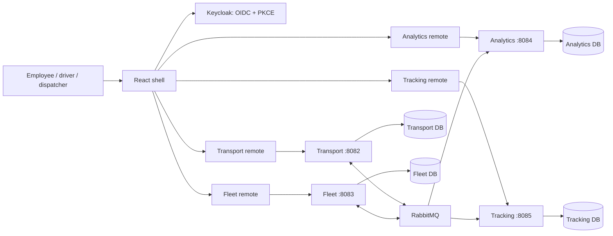

# PlantFlow architecture

PlantFlow is an internal plant transport MVP for on-demand employee rides and scheduled shift shuttles. Its boundaries follow business ownership: transport owns trips, fleet owns vehicles and drivers, tracking owns positions, analytics owns reporting projections, and Keycloak owns identity. Each backend is an independently runnable Spring Boot application with its own database and migrations. A shared Java library supplies infrastructure, not business services.

## Runtime topology

| Module | Responsibilities | Does not own |
| --- | --- | --- |
| Identity | Login, roles, access tokens, account lifecycle | Trips or fleet allocations |
| Transport | Plant pickup/drop-off locations, bookings, shuttle runs and reservations, trip state transitions | Vehicle availability or passwords |
| Fleet | Vehicle/driver catalog, maintenance state, capacity validation, exclusive allocation and release | Booking workflow or report queries |
| Analytics | Versioned trip/fleet projections, KPIs, CSV exports, recent activity | Writes to operational databases |
| Tracking | Authorized location ingestion and position streaming, local trip access projection | Assignment decisions |
| Frontend shell | Login, navigation, theme, loading/error boundaries, shared API client | Remote business screens |
| React remotes | Transport/booking, fleet, tracking, analytics screens | Independent copies of authentication state |

The React shell composes four module-federation remotes. Their build artifacts can be deployed separately; React is shared as a singleton. Each remote accepts shell-provided authentication/API context. Only the shell owns the OIDC lifecycle, and access tokens stay in memory. Configure remote URLs at build time and deploy compatible API contracts together. Federated JavaScript executes with the shell's privileges: remote origins are trusted application infrastructure.

## Asynchronous business workflow

1. Transport validates a booking and commits its trip and `transport.trip-changed` outbox row in one local database transaction.
2. A dispatcher requests assignment. Transport changes the trip to `ASSIGNING`, writes `transport.assignment-requested` and a trip snapshot, and returns HTTP 202.
3. Fleet consumes the request, deduplicates its envelope, locks the requested resources, checks capacity/availability and commits the allocation plus a confirmation or rejection event.
4. Transport consumes the reply, verifies the matching assignment version, changes the trip to `ASSIGNED` or records the rejection, and emits a new snapshot. The UI refreshes the pending state.
5. A driver advances their assigned trip through `ARRIVED`, `IN_PROGRESS`, and `COMPLETED`. Cancellation is restricted by role, ownership, and state. Fleet releases resources after receiving the terminal snapshot.
6. Analytics and tracking consume trip snapshots into their own databases. They never query the transport database.

Scheduled shuttles use the same allocation workflow. Employees reserve capacity on a run; the transport transaction prevents overbooking. A trip cannot be cancelled while its assignment request is awaiting a fleet response. A completed or cancelled trip is terminal.

This is a choreography saga: business state changes travel through events, with fleet rejection forming the normal compensation path. There is no distributed database transaction and no claim of exactly-once delivery. Commands and local reads use HTTP; cross-service business effects use RabbitMQ.

## Event reliability

The transactional outbox prevents a successful business commit from silently losing its event when RabbitMQ is unavailable. The publisher marks an outbox record sent only after broker confirmation. A crash between confirmation and marking it sent can publish the same event again; consumers therefore commit an inbox event ID alongside their local changes. Retry exhaustion routes poison messages to a dead-letter queue for operator inspection.

Event envelopes carry an ID, schema version, aggregate ID/version, UTC occurrence time, actor, and JSON payload. Consumers reject unsupported schemas. Trip and fleet snapshots include monotonically increasing aggregate versions so delayed snapshots cannot overwrite newer facts. Assignment responses retain the request version to reject stale replies. See [event-contract.md](event-contract.md) for exact envelopes and routing.

The analytics projection serializes its writers on a database row. This makes first-insert and version checks safe across replicas with a small implementation appropriate to a single plant. If measured event volume makes that lock a bottleneck, partition projections by aggregate and benchmark concurrency before changing it. The application does not automatically replay historical events into an empty analytics database; preserve/restore its database and outbox/inbox together, or build an explicit snapshot/replay procedure before operational rollout.

## Reporting semantics

- Reporting windows cover UTC calendar days based on trip creation, inclusive of today, between 1 and 90 days.
- Completion rate is completed trips divided by all trips created in the selected window. Cancelled trips remain in that denominator.
- Passengers moved counts passengers on completed trips only. Booked passengers on active or cancelled trips are not counted as transported.
- Average wait measures on-demand booking creation to driver arrival. It excludes shuttles, bookings with no arrival timestamp, and cancelled trips.
- Fleet counters come from the latest accepted fleet snapshot; they are eventually consistent.
- Daily buckets include days with zero trips. Route totals use the same cohort and completed-passenger definition. Reports and CSV exports use the same date filter.
- `lastUpdated` is the latest local projection update represented by the selected facts or fleet snapshot. It is not a broker-lag measurement or a guarantee that all producers are current.
- The activity endpoint returns at most 50 accepted trip snapshot events. It is operational activity, not a full compliance audit ledger; stale snapshots are ignored.

## Realtime position

Tracking is a separate service on port 8085. Its access decisions use a local projection of trip ownership/assignment and passenger reservations. Driver devices publish coordinates for authorized active trips; riders share their own position explicitly through the browser's geolocation permission. Dispatchers receive fleet visibility while riders receive only authorized trip positions. Authenticated fetch-based server-sent events allow a bearer header without leaking tokens in URLs.

Browser coordinates require HTTPS outside localhost, a compatible device, and user permission. Indoor plant GPS can be inaccurate; display freshness and accuracy, and treat the map as an operations aid. Location streaming cannot substitute for collision avoidance or plant safety systems. Continuous background tracking on locked phones requires a dedicated mobile/device integration beyond this browser MVP. Custom indoor maps and positioning hardware require site-specific calibration.

## AOP and security boundaries

Spring AOP centralizes timing and sanitized outcome metadata for controller operations. It does not decide business authorization or capture method arguments, request bodies, passwords, tokens, or coordinates. Domain events retain the actor for operational activity. Services enforce role and ownership rules explicitly, making the same checks apply to every HTTP entry point.

JWT validation, error shaping, database transactions and messaging configuration are shared platform concerns. Domain models and repository SQL stay inside their owning service. [security.md](security.md) describes trust boundaries and production configuration.

## Scope and operational follow-up

The initial scope covers one plant, on-demand transport, scheduled shuttle runs, reservations, dispatch, driver updates, fleet maintenance state, position sharing, and operational reports. It does not implement consumer ride-hailing payments, public fares, payroll, recurring roster generation, route optimization, telematics hardware integration, push/SMS delivery, or multi-plant tenancy.

Before production use, complete a real-broker/PostgreSQL integration run, browser/device GPS checks, outage/replay drills, backup restoration, load tests, security review and site acceptance. Add measured alerting for outbox age, dead-letter depth, event lag, service errors and GPS freshness. Configure retention for trip facts, activity, location history, sent outbox records and inbox IDs together with the replay policy; indiscriminate inbox deletion can reapply old messages.
